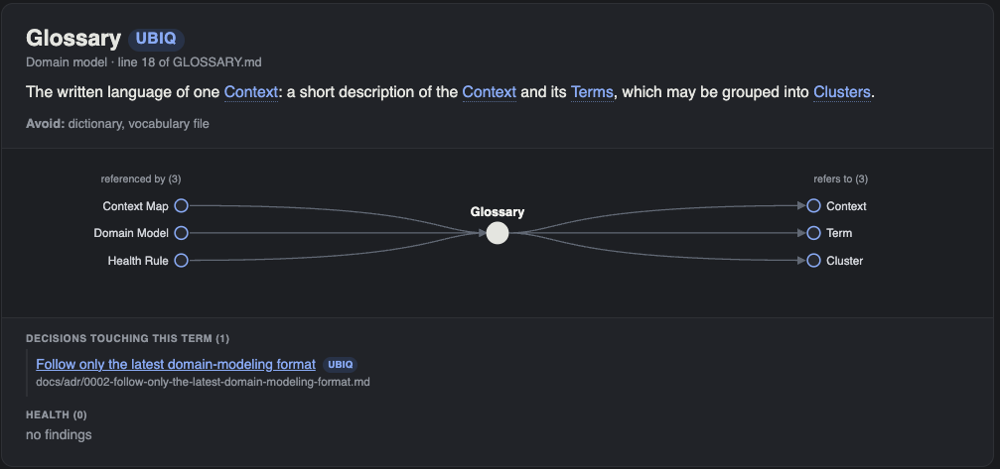

# ubiq

Tooling for a domain-driven design ubiquitous language kept as Markdown in the repository.

ubiq reads the `GLOSSARY.md` glossaries, the `GLOSSARY-MAP.md` context map, and the `docs/adr` decision records that
the [domain-modeling skill](https://github.com/mattpocock/skills/tree/main/skills/engineering/domain-modeling) writes.
It renders them as one HTML page, and it checks both the glossary and other text against the vocabulary.

[](examples/ubiq.html)

**[See ubiq's own glossary rendered as a page](examples/ubiq.html)**

## Install

```sh
go install github.com/stefaneg/ubiq@latest
```

## Get started

Run these commands from the root of a repository that has a `GLOSSARY.md`:

```sh
ubiq html                 # write glossary.html, then open it in a browser
ubiq health               # list long definitions, orphans, unmapped names, and unresolved phrases
ubiq check docs/notes.md  # list the terms a file uses and the capitalised phrases with no entry
```

The [README](https://github.com/stefaneg/ubiq#readme) describes each command, its output, and the layout ubiq reads.

## Learn more

- [Examples](examples/README.md): how to render the example page again, and how to render a larger glossary.
- [ADR 0001: References are bold or capitalised mentions](adr/0001-references-are-bold-or-capitalised-mentions.md)
- [ADR 0002: Follow only the latest domain-modeling format](adr/0002-follow-only-the-latest-domain-modeling-format.md)
- [Source on GitHub](https://github.com/stefaneg/ubiq)

## License

ubiq is released under the [MIT license](https://github.com/stefaneg/ubiq/blob/main/LICENSE).
